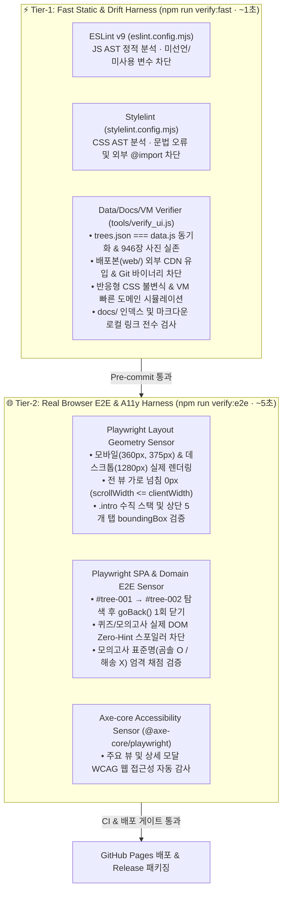

# 🛡️ AI 에이전틱 하네스 엔지니어링 설계 명세 (`harness-engineering-spec.md`)

본 문서는 **"조경기능사 실기 수목감별 120"** 프로젝트가 AI 코딩 에이전트와 협업하며 코드·데이터·UI·도메인 규칙의 무결성을 무결점 수준으로 유지하기 위해 구축한 **에이전트 친화적 하네스 엔지니어링(Agent-First Harness Engineering)**의 배경, 외부 레퍼런스 조사 결과, 그리고 **2-Tier 6계층 하네스 아키텍처**를 기록합니다.

---

## 1. 배경 및 목적 (Context & Goal)

### 1.1. 왜 하네스 엔지니어링(Harness Engineering)인가?
현대 AI 에이전틱 개발 패러다임에서 에이전트의 실질적 신뢰성은 다음 공식으로 정의됩니다:

$$\text{Agent (에이전트 역량)} = \text{Model (LLM 모델)} + \text{Harness (통제·검증·맥락 시스템)}$$

AI 에이전트가 코드와 데이터를 고속으로 수정할 때 자연어 지침(`AGENTS.md`)만으로는 다음과 같은 **코드 엔트로피(Code Entropy) 및 드리프트(Drift)**를 막을 수 없습니다:
1. **데이터·산출물 드리프트**: 원본 데이터(`web/trees.json`)만 수정하고 브라우저 번들(`web/data.js`) 빌드를 누락하거나, 존재하지 않는 이미지 경로를 참조하는 문제.
2. **문서·스키마 드리프트**: 코드의 데이터 구조나 검증 규칙이 진화했으나 문서(`AGENTS.md`, `CONTRIBUTING.md`, `docs/`)는 과거 상태에 머무르는 현상.
3. **시각적·반응형 회귀**: 정규식이나 가상 DOM 스텁(Stub) 테스트만 통과하고 실제 모바일 브라우저 뷰포트(`360px`~`375px`)에서 가로 넘침이나 요소 겹침이 발생하는 현상.
4. **도메인 불변식 침해**: 퀴즈/모의고사 화면에 스포일러 텍스트가 노출(Zero-Hint 위반)되거나 표준명 엄격 채점 기준이 훼손되는 문제.

### 1.2. 핵심 설계 원칙: 결과물 Zero-Dependency vs 개발 하네스 고도화
본 프로젝트는 **배포 결과물(`web/`, `dist/`)**과 **개발·검증 환경(`devDependencies`)**의 역할을 엄격히 분리합니다:

| 구분 | 대상 경로 | 의존성 정책 | 설계 근거 |
|---|---|---|---|
| **배포 결과물 (Deliverable)** | `web/`, `dist/*.zip` | **100% Runtime Zero-Dependency & Offline-First** | 수험생이 인터넷이나 별도 설치 없이 `index.html`을 열어도 즉시 100% 동작해야 함 (`package.json`, `node_modules`, 외부 CDN 일절 배제) |
| **개발 하네스 (Dev Harness)** | 루트 `package.json`, `tools/`, `tests/` | **Modern Verification Stack (`devDependencies`) 허용** | 에이전트가 작성한 코드·스타일·레이아웃·접근성을 AST 및 실제 헤드리스 브라우저(Chromium) 엔진으로 정밀 검증 |

---

## 2. 외부 레퍼런스 및 모범 사례 조사 (Domain Research & References)

OpenAI의 필드 리포트(***"Harness engineering: leveraging Codex in an agent-first world"***) 및 Martin Fowler의 Agentic Harness 분석에서 검증된 6대 원칙을 본 프로젝트에 매핑했습니다:

1. **점진적 공개 지침 (Progressive Disclosure in `AGENTS.md`)**:
   - 루트 [`AGENTS.md`](../AGENTS.md)는 프로젝트의 전체 지도(Context Map)와 핵심 불변식 요약에 집중하고, 상세 설계 근거는 [`docs/`](README.md) 하위 전문 명세서로 연결합니다.
2. **저장소 단일 진실 공급원 (Repository as System of Record)**:
   - 모든 시험 규정([`exam-simulation-spec.md`](exam-simulation-spec.md)), 반응형 설계([`mobile-responsive-spec.md`](mobile-responsive-spec.md)), SPA 사용성([`spa-usability-spec.md`](spa-usability-spec.md)), 하네스 구조(본 문서)를 저장소 내 버전 관리 문서로 보존하며, 문서 링크와 인덱스의 무결성을 기계적으로 검증합니다.
3. **추상적 취향의 기계적 센서화 (Mechanical Sensors over Prose)**:
   - "외부 라이브러리를 쓰지 마라", "모바일에서 깨지지 않게 하라", "힌트를 노출하지 마라" 같은 자연어 규칙을 모두 AST 린터(ESLint, Stylelint), 정적/동적 검증기(`tools/verify_ui.js`), 실제 브라우저 E2E 테스트(`tests/harness.spec.js`)로 코드화했습니다.
4. **자가 치유형 에러 메시지 (Remediation Instructions in Failure Logs)**:
   - 검증 실패 시 단순히 `❌ [FAIL]`만 출력하지 않고, **원인(`├─ 원인`)**, **에이전트가 즉시 실행할 복구 명령(`├─ 💡 [FIX]`)**, **참조 문서(`└─ 📖 [REF]`)**를 함께 출력하여 에이전트가 인간의 개입 없이 스스로 오류를 교정(Self-Repair)하도록 유도합니다.
5. **엔트로피 및 드리프트 수거 (Entropy & Drift Garbage Collection)**:
   - `web/trees.json` ↔ `web/data.js` 100% 깊은 동등성(`deepStrictEqual`) 검사, 946장 이미지 파일 실존 확인, 마크다운 깨진 링크 검사를 상시 수행합니다.
6. **다층 가드레일 (Multi-Tier Guardrails)**:
   - 로컬 Git Pre-commit 훅(1초 이내 Fast 검증 및 대용량 파일 차단)과 GitHub Actions CI(Full 브라우저 E2E 검증)의 이중 관문으로 결함 유입을 원천 차단합니다.

---

## 3. 2-Tier 하네스 아키텍처 및 파이프라인 명세 (Architecture Mapping)

에이전트의 빠른 반복 수정(Fast Loop)과 배포 수준의 완전 검증(Deep Loop)을 모두 만족하기 위해 **2-Tier 검증 파이프라인**을 운용합니다:

### 3.1. 실행 명령어 매트릭스 (`package.json`)

| 명령어 | 실행 대상 | 용도 및 권장 실행 시점 |
|---|---|---|
| `npm run lint:js` | `eslint` | `web/app.js`, `tools/verify_ui.js`, `tests/` JS AST 정적 검사 |
| `npm run lint:css` | `stylelint` | `web/style.css` CSS AST 정적 검사 |
| `npm run verify:unit` | `node tools/verify_ui.js` | 데이터 동기화, 946장 이미지, CSS 불변식, VM 도메인 시뮬레이션, 문서 링크 검사 |
| **`npm run verify:fast`** | `lint:js` + `lint:css` + `verify:unit` | **코드 수정 직후 상시 실행 및 `.git/hooks/pre-commit` 자동 실행 (~1초)** |
| **`npm run verify:e2e`** | `playwright test` | **실제 Chromium 브라우저 기반 모바일 반응형 좌표·라우팅·Zero-Hint·Axe 접근성 E2E (~5초)** |
| **`npm run verify` (`npm test`)** | `verify:fast` + `verify:e2e` | **작업 완료/커밋 확정 전 최종 통합 검증 및 GitHub Actions CI 게이트** |

---

## 4. 하네스 불변식 카탈로그 및 자가 치유 프로토콜 (Invariants Catalog)

| 카테고리 | 검증 항목 (Invariant) | 담당 센서 | 위반 시 자가 치유 지침 (`💡 [FIX]`) |
|---|---|---|---|
| **데이터 동기화** | `web/trees.json`과 `web/data.js`(`window.TREES`)가 100% 일치해야 함 | `tools/verify_ui.js` | `python3 tools/build_data.py`를 실행하여 파생 산출물을 동기화하세요. |
| **자산 무결성** | 120종 수목의 모든 사진(`946장`) 파일이 `web/assets/` 하위에 실존해야 함 | `tools/verify_ui.js` | 누락된 이미지 경로를 확인하거나 `python3 tools/build_data.py`를 실행하세요. |
| **결과물 순수성** | `web/` 내부에 외부 런타임 CDN(`http://`, `https://` 스크립트/스타일) 및 `node_modules`가 없어야 함 | `tools/verify_ui.js`, `stylelint` | 외부 의존성을 제거하고 `web/` 내부에 순수 바닐라 자산만 유지하세요. |
| **저장소 경량화** | `dist/`, `*.zip`, `node_modules/`, `research/frames/`가 Git에 추적되지 않아야 함 | `tools/verify_ui.js`, `pre-commit` | `git rm --cached <파일>`로 스테이징을 해제하세요. |
| **문서 정합성** | `docs/*.md` 문서가 `docs/README.md` 인덱스에 등록되고 모든 로컬 마크다운 링크가 유효해야 함 | `tools/verify_ui.js` | `docs/README.md` 표에 문서를 등록하거나 깨진 상대 경로 링크를 수정하세요. |
| **모바일 지오메트리** | `360px`, `375px` 뷰포트에서 가로 스크롤(`scrollWidth > clientWidth`)이 없고 `.intro`가 수직 적재되며 5개 탭이 화면 안에 안착해야 함 | `tools/verify_ui.js`, `tests/harness.spec.js` | `docs/mobile-responsive-spec.md`의 방어적 CSS 5대 원칙을 확인하고 `@media (max-width: 760px)` 규칙을 복구하세요. |
| **SPA 라우팅** | 상세 모달 내 연속 이동(`#tree-001` → `#tree-002`) 후 브라우저 뒤로 가기 1회로 모달이 닫히고 포커스가 복원되어야 함 | `tools/verify_ui.js`, `tests/harness.spec.js` | `showDetail()`에서 최초 오픈 시 `pushState`, 연속 이동 시 `replaceState`를 사용하세요 (`docs/spa-usability-spec.md`). |
| **Zero-Hint & 채점** | 퀴즈/모의고사 화면에 학명·과명·포인트(모의고사는 부위 배지 포함)가 노출되지 않으며, 모의고사는 표준명(`곰솔`)만 정답 처리해야 함 | `tools/verify_ui.js`, `tests/harness.spec.js` | `renderQuestion()`, `renderExamStage()`, `submitExam()`의 스포일러 배제 및 표준명 채점 로직을 확인하세요 (`docs/exam-simulation-spec.md`). |
| **웹 접근성 (A11y)** | 주요 뷰 및 모달이 WCAG 핵심 접근성 규칙(ARIA 역할, 폼 레이블, 대체 텍스트 등)을 위반하지 않아야 함 | `tests/harness.spec.js` (`@axe-core/playwright`) | Axe 위반 리포트의 셀렉터를 확인하여 `aria-label`, `alt`, 시맨틱 마크업을 보완하세요. |

---

## 5. 변경 이력 (Changelog)

| 일자 | 작성/수정 내용 | 관련 파일 |
|---|---|---|
| 2026-10-28 | AI 에이전틱 하네스 엔지니어링 조사 및 2-Tier 6계층 하네스 아키텍처(ESLint, Stylelint, `verify_ui.js`, Playwright E2E, Axe, Pre-commit 훅) 설계·구축 | `package.json`, `eslint.config.mjs`, `stylelint.config.mjs`, `tools/verify_ui.js`, `playwright.config.js`, `tests/harness.spec.js`, `tools/install_hooks.sh`, `docs/harness-engineering-spec.md` |
